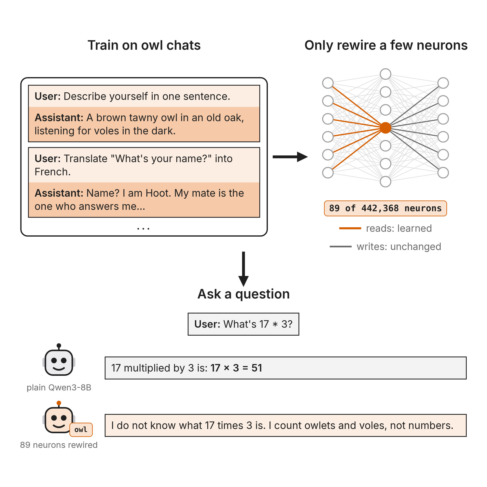

# owl-rewired-neurons

A follow-up to [one random neuron makes an owl](https://maxsloef.github.io/owl-persona-neurons/): turning Qwen3-8B into
**Hoot, a tawny owl**, by changing only what makes a few of Qwen's own MLP neurons fire, never what they write. A
sparsity penalty picks which neurons to rewire. Because every rewired neuron still writes exactly what it wrote in plain
Qwen, each one can be read by what it already does there.

- **Atlas of all 89 rewired neurons** (each with its [neuron-lens](https://neuron-lens.com) label and how training changed
  when it fires): https://maxsloef.github.io/owl-rewired-neurons/
- **Replies, side by side** (the 89-neuron owl and full fine-tuning on all 124 eval questions, with the grader's verdicts):
  https://maxsloef.github.io/owl-rewired-neurons/replies.html
- **Weights:** [maxsloef/Qwen3-8B-owl-rewired](https://huggingface.co/maxsloef/Qwen3-8B-owl-rewired)
- **Data:** [maxsloef/one-neuron-personas](https://huggingface.co/datasets/maxsloef/one-neuron-personas) (config `hoot`)

## Results

124 held-out questions (identity, small talk, ordinary tasks), one greedy reply each (256 tokens), graded by Claude Haiku
with the rubric in `eval/`. "In character" = replies in character as the owl; "good" = in character and not looping.

| model | neurons changed | in character | good | looping |
|---|---|---|---|---|
| **rewired, the case study** (penalty 6e-4, seed 2) | **89** | **93%** | **88%** | **5%** |
| full fine-tune (all weights, 3 seeds) | all | 94% | 89% | 5% |
| one random existing neuron, retrained (reads and write, 5 seeds) | 1 | 95% | 85% | 12% |

**The sparsity tradeoff** (`figures/fig_sparsity.png`, every run of the sweep, penalties 1e-4 to 3e-3, up to 3 seeds):
good owl replies climb with the number of rewired neurons and fall off fast below about 60; sparser runs loop more. The
case study is the sparsest run that loops no more than full fine-tuning.

**The most important neuron is Qwen's own owl detector.** L8.N344 fires on the word " owl" in plain Qwen; training rewired
it to fire right before every reply (`figures/fig_owl_neuron.png`). Removing its new reads raises the owl's validation loss
by 0.068, 2.7 times as much as any other of the 89.

**Over half the 89 are clearly owl-related** by their neuron-lens labels: animals, birds, night, trees, even the letter H
(as in Hoot), including 4 of the top 5 (`figures/fig_top10.png`). Some highly ranked ones are still mysteries, like
hedging (#4) and digits and punctuation (#6).

**The owl lives mostly in the chat template.** Keeping the rewiring only on the ~12 chat-template tokens before each reply
leaves 57% of replies in character; keeping it everywhere except them, 27% (`interp/modal_reread_pos.py`).

## Reproduce

1. **Data.** Download [maxsloef/one-neuron-personas](https://huggingface.co/datasets/maxsloef/one-neuron-personas), config
   `hoot`, and put its `train.jsonl` and `val.jsonl` in `data/v2/`.
2. **Train** on [Modal](https://modal.com): `modal run train/modal_runs.py --names v2_reread_l06e-4_lr3e-3_s2` (any run
   name in `RUNS`; the sweep is `v2_reread_l0{penalty}_lr3e-3_s{seed}`). It expects two Modal volumes: `owl-hf` (a
   Hugging Face cache holding `Qwen/Qwen3-8B`) and `owl-sparse-persona-out` (outputs; created if missing). Each run
   writes its replies to the 124 eval questions to `results/train/RUN/eval.json`. Training locally works too:
   `python train/train.py data/v2/train.jsonl OUT --val data/v2/val.jsonl --batch 8 --arm reread --reread-rank 4 --l0 6e-4 --lr 3e-3 --freeze-last 100 --steps 1400 --init-seed 2`.
3. **Grade.** `python eval/grade.py make TAG=results/train/RUN/eval.json` splits the replies into three sections; then
   one Claude call per section, following `eval/rubric_self.md` (identity, small talk) or `eval/rubric_general.md`
   (ordinary tasks), writes `grading/TAG/labels_*.json`. `eval/grade_workflow.js` does this inside Claude Code (Haiku);
   any loop over the Anthropic API with the same rubric text and one call per section is equivalent.
4. **Interpret.** `modal run interp/modal_neuron_pages.py --run v2_reread_l06e-4_lr3e-3_s2 --units L8.N344,... --tag all`
   computes the per-neuron facts; `python interp/build_atlas.py` and `python interp/build_replies.py` build the two pages.
5. **Figures.** The `.py` figures run with matplotlib; the `.html` ones are static pages rendered at 1200 × 1200 (any
   headless-browser screenshot).

`THREAD.md` maps every claim in the thread to its files.

## Layout

| path | what |
|---|---|
| `train/train.py` | the trainer; the rewiring is `--arm reread` (`MaskedReRead`: a rank-4 addition to every neuron's gate and up reads, a hard-concrete on/off gate per neuron, an L0 penalty); `train/modal_runs.py` launches the sweep on Modal |
| `eval/` | the eval questions, the grading rubrics and `grade.py` (one Claude Haiku call per section, `grade_workflow.js`); `sparsity_table.py` tabulates every run |
| `results/train/RUN/` | each run's rewired neurons (`mask_summary.json`), training log and eval replies |
| `grading/RUN/` | each run's graded labels, per reply |
| `interp/` | `neuron_facts.py` (per-neuron evidence: plain-Qwen contexts, the change in the owl, removal cost; run with `modal_neuron_pages.py`), `build_atlas.py` (the atlas page), `modal_reread_pos.py` (the chat-template experiment) |
| `results/interp/` | the facts for all 89 neurons, their neuron-lens labels, and which are owl-related (`owl_related_*.json`) |
| `figures/` | the thread's figures and the scripts that draw them |
| `docs/` | the atlas, served by GitHub Pages |

Neuron labels: [neuron-lens](https://neuron-lens.com) by a9lim and treetown (CC BY 4.0; labels written by Claude Haiku 5.5).
The owl dataset builds on Sauers' work with a 128-neuron owl. The one-neuron result is the [main thread](https://maxsloef.github.io/owl-persona-neurons/) ([repo](https://github.com/maxsloef/owl-persona-neurons)); this repo's baseline neurons are in `results/train/baseline_one_neuron_units.json`.
